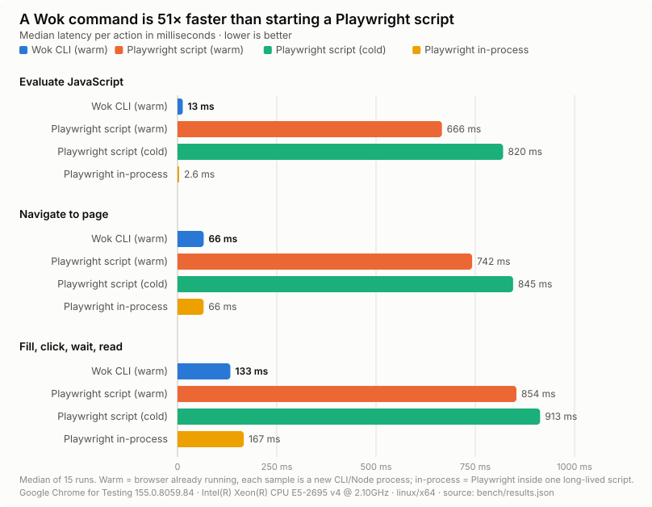
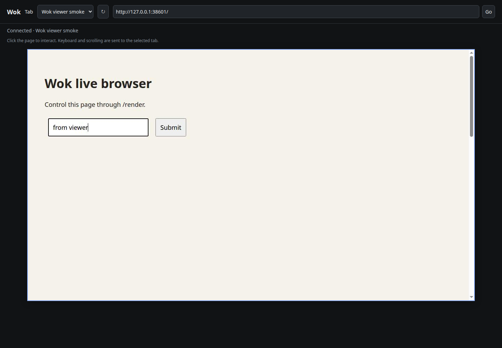

# Wok

A lightweight browser CLI for agents. Start once per profile, attach over CDP,
act, and exit. The browser keeps running with its tabs, cookies, and storage.

Wok is a Go binary with small WebSocket and YAML dependencies. It does not use Playwright or
Puppeteer at runtime.

## Why Wok

Agents drive browsers one shell command at a time. Wok keeps the browser running
and attaches straight to it, so each command costs milliseconds instead of a new
Node process plus Playwright startup.



| Per command (median) | Wok CLI | Playwright script (warm browser) | Speedup |
|---|---:|---:|---:|
| Evaluate JavaScript | 13 ms | 666 ms | 51× |
| Navigate to page | 66 ms | 742 ms | 11× |
| Fill, click, wait, read | 133 ms | 854 ms | 6× |

Both sides attach to the same already-running browser, and every sample is a new
process, which is how agents call tools. Inside one long-lived script Playwright
is equally fast or faster (its in-process bars); Wok gives you that speed from
the shell without writing or hosting a script. Method, p95 and raw samples:
[bench/RESULTS.md](bench/RESULTS.md).

## Install

Linux and macOS:

```sh
curl -fsSL https://raw.githubusercontent.com/alg0rix/wok/main/install.sh | sh
```

Windows (PowerShell):

```powershell
irm https://raw.githubusercontent.com/alg0rix/wok/main/install.ps1 | iex
```

The scripts download the latest [release](https://github.com/alg0rix/wok/releases),
verify its SHA-256 checksum, and install `wok` to `~/.local/bin` (Windows:
`%LOCALAPPDATA%\Programs\wok`, added to the user PATH). Set `WOK_VERSION=v0.1.0`
to pin a release or `WOK_INSTALL_DIR` to change the destination. With Go:
`go install github.com/alg0rix/wok/cmd/wok@latest`.

## Quick start

```sh
wok --profile work start
wok --profile personal start
wok --profile work open https://example.com
wok --profile work snapshot -i
wok --profile work click @e2
wok --profile work screenshot page.png
wok --profile work stop
```

Release binaries cover Linux, macOS and Windows on amd64 and arm64; CI runs the
real-browser suite on all three. Building from source needs Go 1.23 or newer
(`go build -o bin/wok ./cmd/wok`). Automatic browser download covers Linux amd64,
macOS and Windows amd64; elsewhere set `WOK_BROWSER` to an installed Chromium,
Chrome or Edge. Browser binaries are cached separately from the Wok executable. If no browser
is found, `start` downloads Chromium headless shell automatically.

## AI agent setup

```sh
wok skills install                       # project skill for Codex-compatible agents
wok skills install --agent claude
wok skills install --global --agent codex
wok skills show
```

Read the [AI agent guide](docs/agents.md) for session handling, refs, waits,
error recovery, and HTTP control. [Skill installation](docs/skills.md) documents
all targets, custom paths, and overwrite behavior. The installer is offline and
works without starting a browser.

## Browser engine

Wok searches in this order: explicit `--browser` / `WOK_BROWSER`, a
`chrome-headless-shell` on PATH, Wok's cached headless shell, then installed
Chrome/Chromium. If none is found, `start` downloads the current Stable Chromium
headless shell from the official distribution and starts it automatically.

```sh
wok start                    # automatic one-time browser setup if needed
wok browser install          # preinstall/reuse cached browser explicitly
```

The cache is shared across profiles under your OS user cache directory in
`wok/browsers`. Set `WOK_BROWSER_CACHE` to change it. A global lock prevents
concurrent starts from downloading the same browser twice. Subsequent starts
reuse the cached executable without network access. The installer stages the
archive, validates paths and size limits, and publishes a completed installation
atomically. A failed download can be retried without using partial files.

Automatic downloads support Linux x86_64 and macOS arm64/x86_64. On Linux arm64,
install system Chromium and point `--browser` at it; the official headless-shell
distribution does not provide that architecture. An invalid explicit browser
path reports an error instead of silently downloading a replacement.

[Chromium headless shell](https://developer.chrome.com/docs/chromium/headless)
keeps real rendering and CDP while omitting the desktop browser shell.
Downloads come from [Chrome for Testing](https://googlechromelabs.github.io/chrome-for-testing/).
Provisioning requires network access on first use; browser actions run locally.
Start and explicit browser installation default to a five-minute total timeout;
other commands default to 15 seconds. Use `--timeout` to override it.

Wok can also use a locally built Chromium headless shell. An installed Chrome
or Chromium works without downloading another browser. Snap-packaged Chromium
may restrict profile paths, particularly directories under `/tmp`; use a native
binary or a profile root accessible to the Snap.

[Lightpanda](https://lightpanda.io/docs/core-concepts/architecture-overview) is
an open source CDP alternative for DOM/JavaScript tasks, but it has no real
visual layout/rendering. Wok uses Chromium because `/render`, screenshots, and
real hit-tested pointer input require actual rendered pixels. Alternate CDP
engines are not verified as compatible.

## Profiles and lifecycle

```sh
wok --profile work start                 # idempotent while healthy
wok --profile personal start             # independent browser, concurrent
wok profile list
wok --profile work status
wok --profile work render                # live viewer URL
wok --profile work stop                  # personal continues running
wok --profile work start                 # reuse cookies/storage on disk
```

Each profile has a separate browser process, user data directory, CDP port, tab
selection, and ref map. Commands serialize within a profile; independent profiles
can run in parallel. Browser startup uses an OS lock, so concurrent `start`
commands converge on one browser. The viewer can run alongside CLI commands;
concurrent actions on the same tab share focus and page state.

Chrome chooses an available loopback CDP port. `start` returns JSON with the
browser PID, WebSocket endpoint, and viewer base URL (`renderUrl`). Append
`/render` to open the viewer. `--no-render` omits the viewer process;
`wok render` starts it later. Stopping the browser also stops its viewer.
A viewer has an idle footprint and only captures frames while watched.

Use `--headed` for a window. The sandbox stays enabled unless you explicitly
pass `--no-sandbox` (needed in some containers). `--timeout 15s` bounds a command,
including lock acquisition; `--timeout 500ms` is useful for selector checks.
State and logs live under your OS user config directory in `wok/profiles/NAME`.
Set `WOK_HOME` to override that root. State files are mode 0600 and profile
directories mode 0700. `browser.log` and `render.log` contain launch diagnostics.
Profile names accept 1–64 ASCII letters/digits/underscores/hyphens, starting
with a letter or digit. `default` is used when `--profile` is omitted.

After a browser crash, `start` recovers stale metadata and starts a browser using
the same profile data. Normal commands report the unavailable browser rather
than silently starting a new one. Abrupt browser termination has the same disk
persistence limitations as Chromium itself.

## Agent commands

```sh
wok open example.com                     # defaults to HTTPS
wok snapshot -i                          # interactive roles with @eN refs
wok snapshot --json                      # all accessible nodes, JSON
wok click '#submit'                      # CSS or snapshot ref
wok fill @e3 'user@example.com'
wok type 'more text'                     # focused element
wok press Control+a
wok press Enter
wok get text                            # visible page text
wok get text '#result'
wok get attr @e1 href
wok get title
wok get url
wok eval '({title: document.title, url: location.href})'
wok wait --selector '.results'
wok screenshot page.png                 # viewport PNG
wok tab list
wok tab new https://example.org
wok tab select TARGET_ID
wok --tab TARGET_ID get title            # one-command override
wok tab close TARGET_ID
wok cdp Runtime.evaluate '{"expression":"1+1","returnByValue":true}'
wok --browser-level cdp Browser.getVersion
```

Results use JSON on stdout; default snapshots use compact tab-separated text.
Errors are JSON on stderr and return a nonzero exit code. Use `wok help` for
all options. Options may occur before or after the command. `--` ends option
parsing, useful when a literal value starts with an option name.

Refs refer to backend DOM nodes and the document/target that produced them.
They survive CLI exits, fail on navigation/removal, and are refreshed by another
snapshot. Ref numbers increase across snapshots rather than silently reassigning
an old ref. Use CSS selectors for stable automation; ambiguous selectors fail.
Clicks scroll into view and reject disabled/covered elements before dispatching
pointer input. `fill` sends real input events, including for an empty value.

CSS selectors and input actions currently target the main document. Iframe
traversal, shadow-root selectors, file uploads, download management, and a full
Playwright-style locator/actionability layer are outside this version. Snapshots
are a flat accessibility-node listing, not a hierarchical DOM dump.

## Viewport and mobile

```sh
wok --profile work viewport 1280 720
wok --profile work viewport 390 844 --mobile --dpr 3
wok --profile work viewport                  # inspect settings
wok --profile work viewport reset            # restore desktop defaults
```

Settings apply across tabs in the profile, persist after each command, and are
restored when the viewer or browser restarts. New tabs inherit them. Mobile mode
sets device metrics, touch, and a Chromium mobile user agent. It does not change
the browser engine. Pages need an appropriate viewport meta tag for CSS layout
to match the device width; otherwise Chromium may use a wider mobile layout.

Persistent emulation uses the same small resident controller as `/render`;
`viewport` starts it if needed. Use normal `start` to restore emulation after a
browser restart; `--no-render` intentionally omits that controller until `render`
or `viewport` is called. External `--cdp` viewport emulation is not managed here.

## Batch actions and E2E

```sh
wok run examples/login.wok.yaml --var APP_URL=http://localhost:3000 --var TEST_EMAIL=test@example.com
wok run examples/batch.wok.json --var PAGE_URL=https://example.com
```

YAML/JSON flows execute browser actions in process. Add `expect` steps for E2E
assertions, or omit assertions for an agent batch. The runner emits JSON results,
returns a failing exit code on errors, and captures a failure screenshot.
See [the DSL reference](docs/flows.md) for variables, captured results, tabs,
timeouts, assertions, and cleanup behavior.

## Attach an existing browser

```sh
wok --cdp http://127.0.0.1:9222 snapshot -i
wok --cdp ws://127.0.0.1:9222/devtools/browser/ID eval document.title
```

HTTP discovery and browser WebSocket endpoints are supported. External endpoint
refs/tab selection are kept separately from managed profiles. Commands detach
and leave the external browser running. Closing it requires both explicit
`--cdp` and `stop --close-external`. Managed `/render` currently operates on
Wok-owned local profiles.

## Live `/render`

The viewer is an interactive page with tab selection, URL navigation, live MJPEG,
mouse hover/click/drag, scrolling, text/paste, and keyboard shortcuts. It maps
coordinates to the logical viewport so scaled screenshots remain clickable.
`/render?embed=1&tab=TARGET_ID` hides the toolbar for same-origin iframe embedding.



The viewer provides these HTTP endpoints. Tab IDs are Chromium target IDs. Pass `?tab=TARGET_ID` to target a specific tab. Omitting it
selects the first available page; a named tab that does not exist returns 404.
The viewer's selection is local to that viewer; use `--tab` for CLI targeting.

| Method | Path | Behavior |
|---|---|---|
| GET | `/render` | Interactive live viewer; `embed=1`, `tab=` |
| GET | `/render/tabs` | Page targets as JSON |
| GET | `/render/viewport` | Logical width, height, device pixel ratio |
| GET | `/render/screenshot.png` | Viewport PNG; logical-size headers |
| GET | `/render/screenshot.ppm?w=800&h=600` | P6 PPM fitted to optional dimensions |
| GET | `/render/stream.mjpeg` | MJPEG, approximately 5 fps while watched |
| GET | `/render/html` | Current rendered DOM source, sandboxed when viewed |
| POST | `/render/navigate?url=ENCODED_URL` | Navigate to HTTP(S) or about:blank |
| POST | `/render/click?x=100&y=100&button=left` | Pointer click |
| POST | `/render/scroll?dy=-120` | Scroll down roughly 60 px; optional x/y |
| POST | `/render/type?text=ENCODED_TEXT` | Type into focused element; raw body also accepted |
| POST | `/render/key?key=a&mods=ctrl` | Named key or character, optional comma-separated modifiers |
| POST | `/render/move?x=100&y=100&buttons=left` | Hover or drag; optional modifiers |
| POST | `/render/mousedown?x=100&y=100` | Press and hold; optional button/modifiers |
| POST | `/render/mouseup?x=100&y=100` | Release; optional button/modifiers |
| POST | `/render/tab/new?url=ENCODED_URL` | Create a tab |
| POST | `/render/tab/close?tab=TARGET_ID` | Close tab; last tab returns 409 |
| POST | `/render/input` | Typed JSON input alternative |
| GET/POST | `/render/emulation` | Inspect/set persistent profile-wide viewport/mobile settings |

`/render/screenshot` and `/render/stream` are aliases. PNG responses include
`X-Wok-Viewport-Width` and `X-Wok-Viewport-Height`. Input coordinates are CSS pixels.
JSON input types are `click`, `move`, `scroll`, `text`, `key`, and `navigate`:

```sh
curl -X POST "$RENDER_URL/render/input?tab=$TARGET" \
  -H 'Content-Type: application/json' \
  -d '{"type":"text","text":"hello"}'
```

The service binds only to loopback and rejects untrusted Host/Origin headers.
It is intended for local use or a trusted tunnel that rewrites Host/Origin to
the upstream local origin. Cross-origin embedding and arbitrary public listeners
are not supported. Treat CDP and the viewer as browser-control endpoints; do not
publish them directly to an untrusted network. This version does not provide
a bearer-authenticated remote CDP proxy or MCP API.

## Tests and benchmarks

```sh
go test -race ./...
go vet ./...

# Real browser test: isolated profiles, concurrent start, lifecycle, refs, input,
# screenshots, storage, tabs, stream frames, HTTP control, and origin protection.
WOK_TEST_BROWSER=/absolute/path/to/chrome-headless-shell go test -race ./... -count=1

# Playwright is a development-only benchmark and viewer-test dependency.
npm ci --prefix bench
WOK_BENCH_BROWSER=/absolute/path/to/chrome-headless-shell node bench/viewer-smoke.mjs
WOK_BENCH_BROWSER=/absolute/path/to/chrome-headless-shell WOK_BENCH_N=20 node bench/benchmark.mjs
```

[Benchmark results](bench/RESULTS.md) include medians, p95, environment, methodology,
and [raw samples](bench/results.json). They compare shell subprocesses as well as
an already-running Playwright client. Playwright can also reuse a browser;
its cold launch is one measured lifecycle choice, not an inherent limitation.
